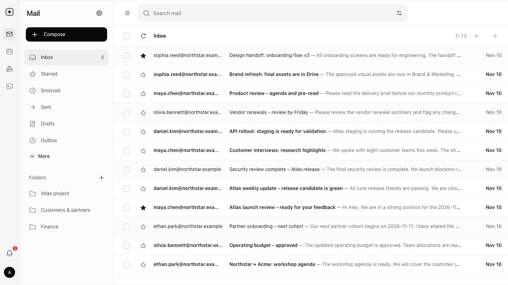

  
  <h1>Officeflare</h1>
  
A self-deployable office workspace suite built on Cloudflare.

## Installation

Click **Deploy to Cloudflare** above and follow the setup steps to install Officeflare in your own Cloudflare account.

## Features

- **Mail**

  - **Mailboxes**: Personal and shared inboxes, domains, and aliases.
  - **Composer**: Rich text, tables, images, and attachments.
  - **Conversations**: Threads, replies, forwarding, and drafts.
  - **Delivery**: Scheduled sending and undo.
  - **Organization**: Search, folders, stars, and snooze.
  - **Automation**: Rules, blocked senders, and automatic replies.
  - **Integrations**: APIs, webhooks, JMAP, and MCP.

- **Calendar**

  - **Views**: Day, week, month, and agenda.
  - **Calendars**: Personal and shared calendars with permissions and colors.
  - **Scheduling**: Recurring events, time zones, and availability.
  - **Guests**: Invitations and attendance responses.
  - **Sharing**: Attachments and public event links.
  - **Sync**: Calendar subscriptions and ICS imports/exports.
  - **Registration**: Public event sign-ups.

- **Drive**

  - **Storage**: Files, folders, and uploads.
  - **Browsing**: List/grid views, search, and filters.
  - **Previews**: PDFs, images, and text.
  - **History**: Versions, comments, activity, and trash recovery.
  - **Permissions**: Viewer, commenter, and editor roles.
  - **Links**: Passwords, expiration, and download controls.
  - **Policies**: Storage quotas and sharing rules.

- **Workspace**

  - **Languages**: English, Korean, and Japanese.
  - **Interface**: Light/dark themes and responsive layouts.
  - **Notifications**: In-app workspace updates.
  - **Accounts**: Profiles, MFA, and session management.
  - **Administration**: Users, roles, and permissions.

## Contributing

Thank you for your interest in Officeflare. We are not accepting code contributions or pull requests at this stage. Bug reports, feature requests, and feedback through [GitHub Issues](https://github.com/nemorize/officeflare/issues) are very welcome.

Please report security issues privately to [jiyong.kim@headercat.com](mailto:jiyong.kim@headercat.com).

## License

Copyright © 2026 Ji Yong, Kim and the Officeflare contributors.

Officeflare is licensed under the **GNU General Public License v3.0 only** (`GPL-3.0-only`). See [LICENSE](LICENSE) for the full terms. Third-party components and bundled assets retain their respective licenses.
